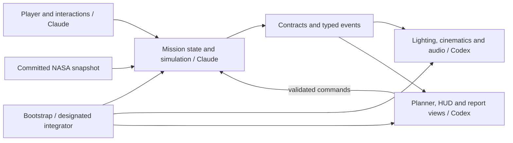

# Architecture

## Technical baseline

- Unity **6000.3.28f1**, C#, URP, Windows x64.
- Existing URP project retained; original scenes, assets and `.meta` GUIDs preserved.
- Existing packages include Input System, Timeline and Unity Test Framework. Reuse them before proposing additions.
- Visible Meta Files and Force Text serialization are required. Text scenes and prefabs stay in normal Git; large binary source assets use Git LFS.

## Composition

`OutOfReach.Contracts` contains small C# interfaces, immutable/read-only values and typed events. It must not depend on scene objects or presentation. Claude implements deterministic domain services and Unity adapters. Codex renders their state and reacts to events. Presentation must not keep a second authoritative oxygen counter, charge battery costs, trigger a successful repair, or award a win independently.

The composition root supplies interface references explicitly. Do not introduce service locators, reflection-based discovery, networking, ECS, or a dependency-injection package for this slice. Keep model updates independent of frame rate. Runtime services use one simulation clock; presentation transitions can use real elapsed time while the game is paused.

## Scene and prefab strategy

Planned integration scene: `Assets/_OutOfReach/Scenes/Bootstrap.unity`. Only the designated integrator creates or changes it after baseline. Bootstrap composes domain services, the player, UI and visual environment. It owns the single active player camera and audio listener in gameplay.

Codex creates independent visual prefabs and, where useful, an additive visual scene under `Scenes/Visual/`. Visual preview scenes may use a temporary camera, but that camera must be disabled or excluded when integrated. No gameplay singleton or resource authority lives inside a visual room prefab.

Use stable named transforms for integration: `PlayerSpawn`, `CockpitConsole`, `PowerRepair`, `LifeSupportRepair`, `AirlockInner`, `AirlockOuter`, `EvaStart`, `AntennaRepair`, `EvaReturn`, and `FinaleCameraAnchor`. Use these names as authoring aids; the integrator binds serialized references instead of searching the hierarchy by string at runtime. Units: one Unity unit equals one metre. Y is up, local Z is forward. First-person eye height target: 1.65 m; clear passage width target: at least 1.2 m.

Each system's prefab has one clear owner. Claude's gameplay components are attached by the integrator to Codex's visual anchors, or placed on separate gameplay children. Never have both branches edit the same prefab or scene YAML.

## File ownership

Designated integrator: **Codex**, explicitly selected by Alex on 14 November 2026.
Latest user-directed exception: ship modeling/remodeling belongs to a dedicated Claude/Fable writer
in `Assets/_OutOfReach/Visuals/Models/Aurora7/**` plus metadata. Codex retains lighting, presentation
and integration of delivered models. Existing ship prefabs/builders stay with Codex until an exact
handover is coordinated. See CODEX-006 and issue #7; no two writers edit the same asset.

| Owner | Paths | Responsibility |
|---|---|---|
| Codex | `Assets/_OutOfReach/Visuals/**`, except the model scope above | Materials, lighting and integration of environment assets |
| Claude/Fable model writer | `Assets/_OutOfReach/Visuals/Models/Aurora7/**` | Ship model source/exports, model materials/textures, license manifest and genuine renders |
| Codex | `Assets/_OutOfReach/Scenes/Visual/**` | Visual authoring and preview scenes |
| Codex | `Assets/_OutOfReach/Scripts/Presentation/**` | View adapters, cinematics, lighting and visual editor utilities |
| Codex | `Assets/_OutOfReach/UI/**` | Planner, HUD, report and menu presentation |
| Codex | `Assets/_OutOfReach/Audio/**` | Original/licensed audio and mixer presentation |
| Codex | `Assets/_OutOfReach/Prefabs/Visual/**` | Modular visual prefabs |
| Claude | `Assets/_OutOfReach/Scripts/Core/**` | State machine, mission orchestration and domain event bus |
| Claude | `Assets/_OutOfReach/Scripts/Simulation/**` | Resources, repairs, communication timing and science model |
| Claude | `Assets/_OutOfReach/Scripts/Interaction/**` | Interaction resolution and gameplay adapters |
| Claude | `Assets/_OutOfReach/Scripts/Player/**` | Input, first-person controller and EVA movement |
| Claude | `Assets/_OutOfReach/Scripts/Inventory/**` | Equipment, parts and loadout domain behavior |
| Claude | `Assets/_OutOfReach/Tests/**` | Domain and gameplay EditMode/PlayMode tests and test fixtures |
| Integrator | `Assets/_OutOfReach/Scripts/Contracts/**` | Shared interface schema and its assembly definition |
| Integrator | `Assets/_OutOfReach/Scenes/Bootstrap.unity` and its `.meta` | Composition and integration scene |
| Integrator | `Packages/**`, `ProjectSettings/**` | Dependencies, engine and build settings |
| Integrator | Root docs, `docs/**`, `tools/**`, Git configuration files, shared data paths | Shared coordination, provenance, tooling and release evidence |

Ownership includes `.meta`, nested `.asmdef`, prefabs and assets within each path. The initial foundation is assembled by Codex as bootstrap integrator. This does not grant ongoing permission to edit shared files after baseline. Both humans must coordinate a named integrator and exact shared change before subsequent edits. Unlisted paths are unassigned: request a path assignment before writing them.

## Naming and boundaries

Namespaces follow `OutOfReach.Contracts`, `OutOfReach.Core`, `OutOfReach.Simulation`, `OutOfReach.Interaction`, `OutOfReach.Player`, `OutOfReach.Inventory`, `OutOfReach.Presentation`. Prefer one public type per file. C# type/file names use PascalCase; private fields use camelCase. Name quantities with units, such as `DistanceKm`, `ElapsedSeconds` and `EnergyKWh`.

Contracts are the only compile-time dependency between domain and presentation. Use small assembly definitions where needed for test isolation; changes spanning both owners must be coordinated. Tests may depend on runtime assemblies; runtime code must not depend on tests or `UnityEditor`. Keep editor utilities in an `Editor` subfolder within the owning path.

## Failure behavior

Commands validate before mutating. Failed commands do not consume resources or publish success events. Repeated interactions do not duplicate rewards, repairs or signals. Resource values remain finite and within valid bounds. Pausing stops simulation consumption and communication timers. Restart creates a clean mission and clears event subscriptions. Every scene load/unload unsubscribes presentation listeners.
